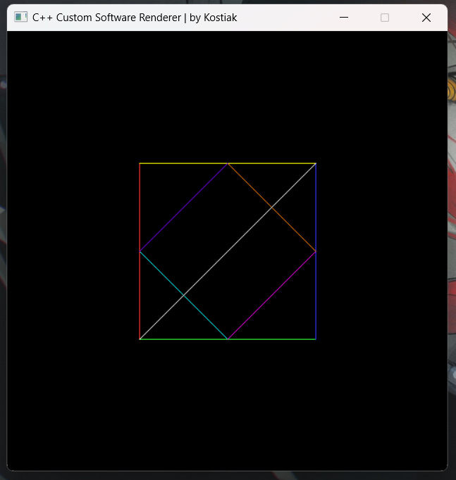
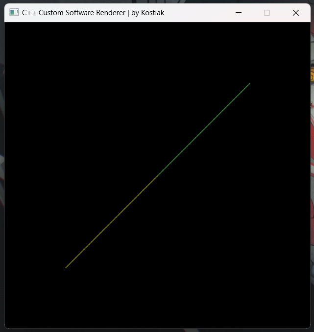

# CustomSoftwareRenderer
BY VOLODYMYR KOSTIAK
A lightweight software renderer written from scratch in C++ using SDL2. Designed to provide an understanding of the graphics pipeline, rasterization, and low-level pixel manipulation without relying on hardware acceleration (OpenGL/Vulkan).

## Requirements
- C++17 compiler (MSVC / GCC)
- CMake 3.15+
- SDL2 development libraries

